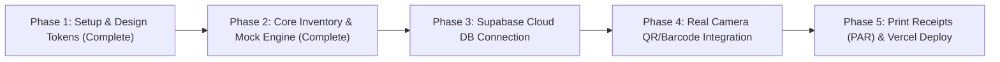

# Barangay Asset & Item Tracking System (BAITS)
> A modern, zero-cost, Apple-inspired chain-of-custody tracking platform designed for municipal IT departments managing equipment across **16 Barangays**.

---

## 📌 Problem Overview & Purpose

Municipal IT departments routinely deploy critical hardware—such as printers, network routers, gigabit switches, and desktop workstations—to administrative outposts and **16 decentralized barangays**. 

Common operational breakdowns include:
1. **Spreadsheet De-synchronization:** Static Excel records diverge quickly from reality, creating "ghost equipment".
2. **Untracked Transfers:** Hardware is loaned out for elections, community registration, or temporary repairs without an immutable custody receipt.
3. **No Field Accessibility:** Bulky enterprise ERP systems fail when barangay secretaries or field couriers attempt to verify serial numbers on mobile phones.
4. **License Cost Prohibitions:** Commercial asset management platforms charge steep per-seat monthly subscription fees.

**BAITS** solves this by pairing a **\$0/month serverless architecture** with an **Apple Human Interface Guidelines (HIG)-crafted UI** optimized for mobile, tablet, and desktop field operations.

---

## ⚡ Key Architectural Pillars

### 1. Minimalist Apple-Style UI (Anti "AI-Slop")
- **True Cupertino Craftsmanship:** Built with intentional whitespace, subtle border definition (`rgba(0,0,0,0.06)`), frosted glass headers (`backdrop-blur-xl`), and refined neutral tones (`#F8F9FA` / `#1D1D1F`).
- **Zero AI Cliché:** No meaningless gradient neon cards, no unnecessary glowing charts, and no artificial purple drop-shadows.
- **Micro-Typographic Precision:** Tight tracking, tabular monospace serials (`font-mono`), and muted status badges (Apple System Green, Blue, Amber).

### 2. Fully Responsive & Field Ergonomics
- **Desktop:** High-density data table with quick filter pills, one-click serial copying, and audit timeline inspectors.
- **Mobile / Smartphone:** Touch-friendly card views with bottom thumb navigation and browser-native camera barcode/QR scanning.

### 3. \$0/Month Operating Cost (Free-Tier Stack)
| Layer | Technology | Free Tier Allocation |
| :--- | :--- | :--- |
| **Frontend** | React 19 + TypeScript + Vite | Unlimited local build & static bundle |
| **Styling** | Tailwind CSS v4 + Lucide Icons | Zero runtime cost |
| **Hosting & CI/CD** | Vercel or Netlify | 100 GB/mo bandwidth, global edge CDN, automated HTTPS |
| **Database & API** | Supabase (PostgreSQL) | 500 MB DB storage (supports 200,000+ transfer records) |
| **Field Scanning** | Browser `BarcodeDetector` / Camera API | Free, zero paid third-party scanning SDKs |

---

## 🗄️ Data Model & Tracking Schema

The system tracks every movement as a verifiable chain-of-custody transaction:

- **Assets:** Item name, category, brand/model, unique hardware serial number, asset tag, current location, status (`in_service`, `in_transit`, `under_repair`, `standby`), and assigned custodian.
- **16 Barangays + Central Depot:** Pre-seeded in [`supabase/schema.sql`](file:///c:/Users/johns/OneDrive/Documents/HIMUIT/supabase/schema.sql) with contact liaisons and addresses.
- **Asset Transfers:** Two-stage dispatch and receipt workflow generating unique reference IDs (e.g. `TR-2026-4821`), recording timestamps, dispatchers, recipients, and operational purpose.
- **Automated Database Triggers:** When a transfer is marked `received`, the asset's location automatically flips to the destination and returns to `in_service`.

---

## 🚀 Development Phases



1. **Phase 1: Setup & Cupertino Design Tokens (✅ Completed)**
   - Initialized React 19 + TypeScript + Vite environment with Tailwind CSS v4 and Lucide Cupertino icons.
2. **Phase 2: Core Inventory & Transfer Engine (✅ Completed)**
   - Pre-configured 16 Barangays and Municipal Depot.
   - Built live Transfer modal, Hardware inspector sheet, and Chronological Audit Trail.
   - Persistent `localStorage` state with instant demo reset capability.
3. **Phase 3: Supabase Backend Integration (Next)**
   - Connect Supabase client via `.env` credentials (`VITE_SUPABASE_URL` and `VITE_SUPABASE_ANON_KEY`).
   - Execute [`supabase/schema.sql`](file:///c:/Users/johns/OneDrive/Documents/HIMUIT/supabase/schema.sql) in the Supabase SQL editor.
4. **Phase 4: Camera Barcode Reader & Mobile PWA (Next)**
   - Hook up `Html5-QRCode` or native `navigator.mediaDevices` stream to the Quick Scan modal.
5. **Phase 5: Property Acknowledgement Receipt (PAR) & Production Deployment (Next)**
   - Add printable PDF Property Acknowledgement Receipt slip for government compliance.
   - Deploy to Vercel/Netlify with one-click git push.

---

## 💻 Getting Started

### 1. Run Locally
```bash
# Clone or navigate to the directory
cd HIMUIT

# Dependencies are pre-installed; start the Vite dev server
npm run dev
```

Visit `http://localhost:5173` in your browser.

### 2. Build for Production
```bash
npm run build
```

### 3. Connect to Supabase (Optional for Cloud Sync)
1. Create a free project at [supabase.com](https://supabase.com).
2. Go to **SQL Editor** and paste the contents of [`supabase/schema.sql`](file:///c:/Users/johns/OneDrive/Documents/HIMUIT/supabase/schema.sql).
3. Copy your project URL and Anon key into a `.env.local` file:
   ```env
   VITE_SUPABASE_URL=https://your-project.supabase.co
   VITE_SUPABASE_ANON_KEY=your-anon-key
   ```
